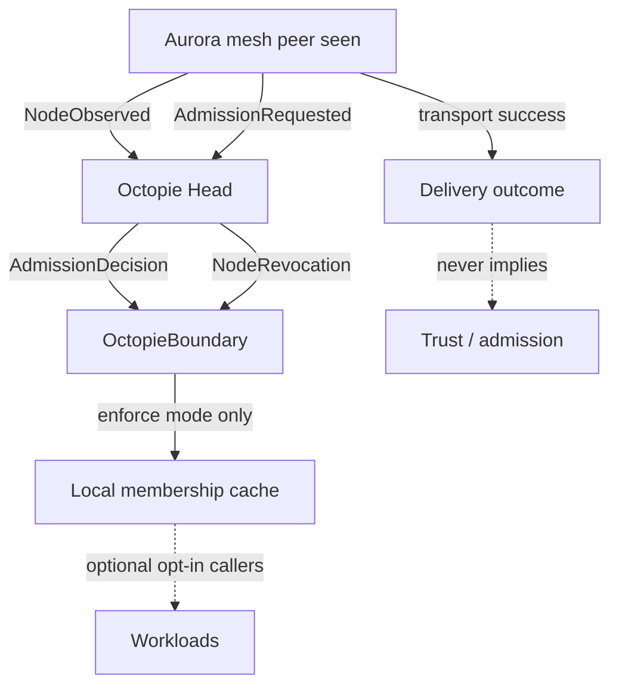

# Octopie Integration (Aurora side)

**Contract version:** `octopie-aurora/1.0`  
**Default mode:** `disabled`

## Roles

| Project | Owns |
|---------|------|
| **Aurora** | Mesh, discovery, routing, transport, artifact history, network health |
| **Octopie** | Identity verification, authorization, admission/revocation, expansion budgets |

Aurora supplies observations. Octopie supplies trust decisions. Aurora may **cache** decisions only with explicit TTL and must **fail closed** when authority is missing, stale, or revoked.



## Configuration

| Variable | Values | Default |
|----------|--------|---------|
| `AURORA_OCTOPIE_MODE` | `disabled` / `observe_only` / `enforce` | `disabled` |
| `AURORA_OCTOPIE_DECISION_MAX_AGE` | seconds | `600` |

**Safe enablement path**

1. Deploy with `disabled` (no behaviour change).
2. Switch to `observe_only` — decisions are validated and logged; no privileges granted.
3. After verifying contract version, TTL, and revocation, switch to `enforce` for callers that explicitly check `OctopieBoundary.is_trusted`.

Mesh join, discovery, and destination routing continue to use Aurora's existing policy (`comms/routing/policy.py`, `MESH.md`). Public egress relay remains off.

## Module

```
comms/octopie/
  __init__.py
  contract.py     # mirror of octopie-aurora/1.0
  boundary.py     # fail-closed consumer
```

## Tests

```bash
python -m pytest tests/test_octopie_boundary.py -q
```

These tests require **no** Octopie install, **no** network, **no** credentials.

## Implemented vs planned

| Item | Status |
|------|--------|
| Contract models + version check | Implemented |
| Fail-closed boundary (disabled / observe / enforce) | Implemented |
| Isolated unit tests | Implemented |
| Live Redis/mesh adapter wiring into `mesh_join` | **Not** implemented — mesh behaviour unchanged |
| Automatic enrollment of public peers via Octopie | **Not** implemented (by design) |
| Multi-head / HA for Octopie | Planned on Octopie roadmap |

## Related docs

- Octopie: `docs/OCTOPIE_AURORA_CONTRACT.md`
- Aurora mesh: `MESH.md`
- Destination routing: `docs/DESTINATION_ROUTING.md`
